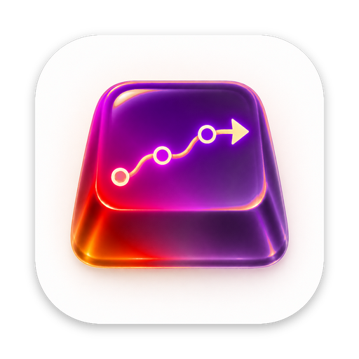
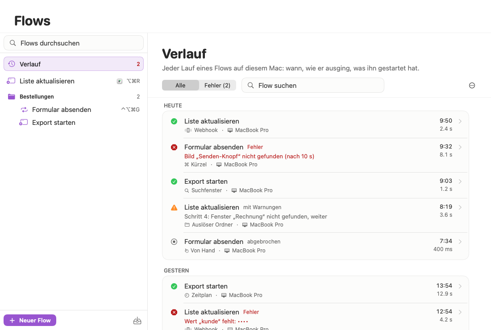
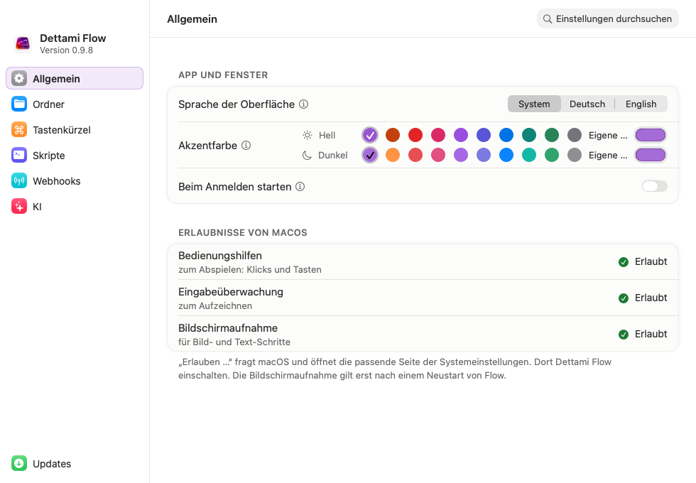
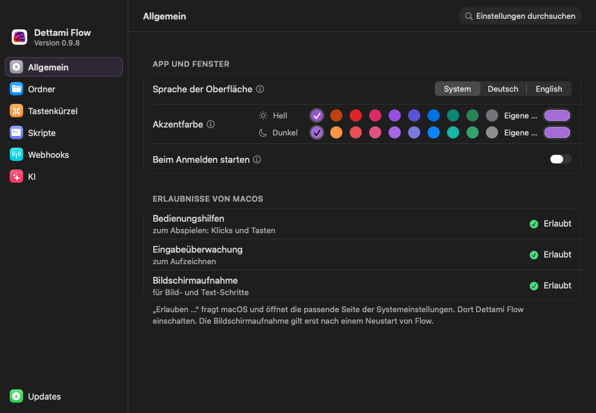
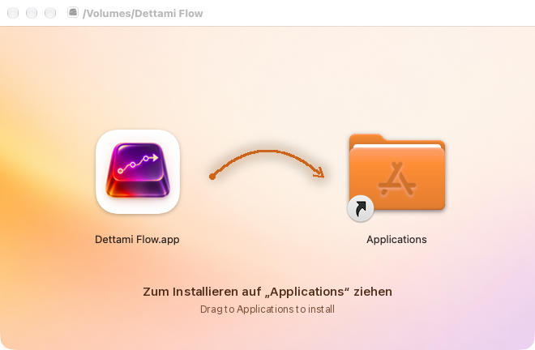

<div align="center">

[Deutsch](README.md) · **English**



# Dettami Flow

**Automations for your Mac: click, type, control windows, run scripts and AI, by shortcut, on a schedule or from your iPhone.**

Free · for macOS 26 and later · notarized by Apple

<a href="https://github.com/Stebibastian/dettami-flow-releases/releases/latest"></a>

<a href="https://github.com/Stebibastian/dettami-flow-releases/releases/latest"></a>


<br>



<sub>Screenshots show the German interface; Flow is also available in English.</sub>

</div>

---

## What it is

Dettami Flow takes repetitive work off your hands. A **flow** is a sequence of steps: click a button or some text on screen, type text, press keys, bring an app to the front, run a script, ask the AI. It starts by keyboard shortcut, on a schedule, when an app comes to the front, when a file lands in a folder, from the clipboard or from your iPhone.

Flow is the automation app of the [Dettami](https://apps.apple.com/app/id6812090257) family (dictation, clipboard, snippets, Quick AI). Since Dettami 1.2, Dettami's former macros run here.

## At a glance

| | |
|---|---|
| 🧩 **Flows from building blocks** | Clicks, keys, text, pauses, windows, menu items, links, branches, loops, variables, prompts, notifications |
| 👁️ **Sees the screen** | Wait for text or an image and click it, even if the window moves |
| ⚡ **Many triggers** | Shortcut, schedule, interval, app, folder, clipboard, webhook |
| 📜 **Scripts** | Shell, Bash, AppleScript, JavaScript, Python inline or from the `_skripte/` scripts folder |
| ✨ **AI steps** | “Ask AI” and an AI assistant that suggests flows in a chat |
| 📁 **Your folder** | One readable JSON file per flow, in iCloud Drive, OneDrive, Nextcloud, Dropbox, on a NAS or in Git |
| 📡 **Channels** | Share flows with colleagues, including Macs without iCloud |
| 📱 **Remote** | Start flows from your iPhone with Dettami from the App Store |

## Features

### Build flows

- **New flow** with ⌘N: empty from the building blocks, **Record** (clicks and keys are captured step by step) or **Create with AI** (describe in a chat what the flow should do; the AI suggests the steps).
- Templates for common jobs: **Text from the screen** (drag a region, recognize text, copy it) and **Remap Shortcut** (a shortcut of your own in an app that presses another key or picks a menu item).
- **Building blocks**: click (also at the pointer), click on text or an image, wait for text or an image, type text, keys, pause, activate app, open link, choose menu item, arrange window, set variable, prompt, show notification, branch, loop, “for each”, comment, script, Telegram message and more.
- **Test** like in a debugger: step by step, turn single steps off, undo.
- **Import** from Keyboard Maestro (`.kmmacros`) and from shared flow code.
- **Applies In**: a flow or a whole folder of flows works everywhere or only in certain apps.

### Triggers

A flow starts by hand, from the menu bar or through one or more triggers:

- **Keyboard shortcut** (Flow warns if Dettami already uses it)
- **Schedule** (daily times) and **interval** (every n minutes)
- **App**: when a given app launches, quits, comes to the front or goes to the background
- **Folder**: when a file is added to or removed from a folder
- **Clipboard**: when text or an image is copied
- **Webhook**: from outside, e.g. from your iPhone (see below)

### Start quickly: Search Flows

**⌃⌥⌘M** or the menu bar opens the **Search Flows** window: type, narrow down with `#folder`, see steps and details, press ↩ to run in the app you were using. ⌘K shows more actions (edit, show in Finder, turn off, step by step).

### History

Above the list sits the **History**: every run on this Mac with time, duration, result, error line, trigger and Mac, grouped by day, with an “All | Errors” filter and search. Typed and secret values never appear in it.

### Scripts folder `_skripte/`

- Your flow folder contains `_skripte/`. The **Script from File** step runs a script from it as in Terminal. Change the file and every flow using it picks up the change at once.
- Settings > Scripts lists them, creates new ones, sets the executable flag and shows them in Finder.
- **More script folders** can be added, e.g. your Raycast Script Commands. Flow runs them in place without copying. “Copy to _skripte” lets a script travel with your flows.

### A folder, not a database

Flow keeps everything in a **folder you choose**: iCloud Drive, OneDrive, Nextcloud, Dropbox, a NAS or a Git repository.

```
Flows/
  _flow.json                       order, folders, favorites, settings
  Submit form (3F2A9C1B).json      one flow, readable JSON
  Submit form (3F2A9C1B).bilder/
  Office/                          a folder of flows
  _skripte/                        scripts for “Script from File”
  _papierkorb/                     deleted flows, never gone for good
```

- **One file per flow**, neatly formatted: Git diffs show exactly what changed.
- Changes from another Mac arrive on their own. On a conflict, Flow asks which version to keep.
- If the folder can’t be reached (offline, drive unplugged), Flow keeps working with the last state.
- Deleted flows go to `_papierkorb/` (trash), not into the void.
- **Secret variable** values are never stored in the folder; they stay in the keychain.

### Channels: share flows with your team

New in 0.10.0. One Mac **publishes** flows or whole folders to a shared folder, other Macs **subscribe** to it in Settings > Channels.

- Works with **OneDrive and SharePoint**, a **NAS (SMB)** or **Dropbox**. No iCloud needed.
- Subscribed flows sit in a group of their own with a lock: they run, with shortcuts and triggers, but are read-only. **Edit a Copy** turns one into a flow of your own. Triggers can be turned off per Mac.
- Changes and withdrawn flows arrive on their own. If the channel is offline, its flows keep running in their last version.
- **Secret values never go into a channel.** If a secret variable is missing on the other Mac, Flow shows “missing, please enter it” and stores it there in the keychain.

### Remote control from your iPhone

With [Dettami for iPhone](https://apps.apple.com/app/id6812090257) you start flows from your iPhone, pick the Mac and see whether the run worked. The message goes through a webhook service (ntfy), set up in Flow under Settings > Webhooks. Flow can also send messages to Telegram.

> The list of flows reaches the iPhone through Dettami on the Mac and its iCloud sync. The remote therefore needs Dettami on both Mac and iPhone.

### AI

- **Ask AI** step and an **AI assistant** for flows, with Claude, ChatGPT, Apple Intelligence or a local model via **Ollama**.
- For Claude and ChatGPT, Flow uses your own key from Dettami (Improve Text); it is never shown. You confirm a notice before the first request. Only what the step names is sent, never secret variables.

### Look and feel

Settings in the style of Dettami, with search, interface language (German or English) and your own **accent color** for light and dark. Out of the box a soft violet.

<div align="center">


</div>

## System requirements

- **macOS 26 (Tahoe) or later**, Apple silicon or Intel
- For the iPhone remote: Dettami on Mac and iPhone
- For Claude or ChatGPT: your own key, entered in Dettami. Apple Intelligence and Ollama need no key.

## Installation

1. **[Download the latest version](https://github.com/Stebibastian/dettami-flow-releases/releases/latest)**: under “Assets”, the file `DettamiFlow-<version>.dmg`.
2. Open the DMG and **drag Dettami Flow onto “Applications”**.

   

3. Start Dettami Flow from the Applications folder. Setup takes three short steps:
   - **Choose Folder** for your flows. If it already holds an export from Dettami, Flow loads it.
   - **Import from Dettami** if you had macros in Dettami (see FAQ).
   - Grant the macOS **permissions**:

| Permission | What for |
|---|---|
| **Accessibility** | Play back clicks and keys |
| **Input Monitoring** | Record clicks and keys, keyboard shortcuts |
| **Screen Recording** | Image and text steps (finding text or an image on screen) |

“Allow …” opens the right page of System Settings. Screen Recording only takes effect after Flow restarts, so there is a “Restart Flow” button. Later you’ll find everything in Settings > General.

## Updates

Flow updates itself with [Sparkle](https://sparkle-project.org). Updates come signed from this repository.

- Settings > Updates > **Check for Updates Now …**, or
- turn on **Check for updates automatically**, and Flow checks once a day.

Automatic checks are off by default: without a click or the switch, Flow never asks for updates.

## FAQ

<details>
<summary><b>Is Dettami Flow free?</b></summary>

Yes. Flow is free, with no subscription, no paywall and no account.
</details>

<details>
<summary><b>Why isn’t Flow in the App Store?</b></summary>

Mac App Store apps run in a sandbox. Flow has to control other apps, play back clicks and keys, run scripts freely and watch folders you pick. In the sandbox that is impossible or heavily restricted. So Flow comes straight from here: **signed with Developer ID and notarized by Apple**, updates through Sparkle.
</details>

<details>
<summary><b>Where are my macros from Dettami?</b></summary>

Since Dettami 1.2, macros run in Dettami Flow. Dettami doesn’t delete them; they stay safe on your Mac. To bring them over:

- **Easiest:** on Flow’s first launch, choose “Import from Dettami”. Flow reads the macros and their images from Dettami (read-only), plus the webhook and Telegram settings. Secret variable values and tokens are not copied.
- **Or export:** in Dettami, Settings > General > “Export macros to folder …”, then open that folder on Flow’s first launch.

While Flow is running, Dettami pauses its own macro triggers so nothing runs twice.
</details>

<details>
<summary><b>Do I need iCloud?</b></summary>

No. Flow needs no iCloud account and no Apple sync. Your flows live in a folder of your choice. For several Macs, use a folder in iCloud Drive, OneDrive, Nextcloud or Dropbox, or share flows through channels. Only the iPhone remote uses Dettami’s iCloud sync.
</details>

<details>
<summary><b>How do I share flows with colleagues?</b></summary>

With **channels** (Settings > Channels): on your Mac choose “Create Channel …” and a shared folder (OneDrive, SharePoint, NAS or Dropbox), then right-click flows and pick “Publish to Channel”. Share the folder with the others (read-only is enough). On every other Mac choose “Subscribe to Channel …” and the same folder. Secret values never travel along.
</details>

<details>
<summary><b>Is the app signed? Will macOS warn me?</b></summary>

The app is **signed with Developer ID and notarized by Apple** (Gatekeeper: “Notarized Developer ID”), and so is every update. It opens without any “Open Anyway” detour.

An honest note about the wrapper: the **DMG file itself** is notarized but doesn’t carry its own signature yet. You won’t notice when installing, because macOS checks the app when it starts. DMG signing will come with one of the next releases.
</details>

<details>
<summary><b>What happens to my data?</b></summary>

See [Privacy](#privacy): Flow has no account, no analytics and no telemetry. Only what you set up yourself goes online.
</details>

<details>
<summary><b>Where is the source code?</b></summary>

Dettami Flow is not open source. This repository only holds the releases (DMG and update files) and the `appcast.xml` update feed for Sparkle.
</details>

## Privacy

- **No account, no analytics, no telemetry, no ads.**
- Flows are files in the folder you choose. Secret variable values live only in the Mac’s keychain.
- Flow only goes online for what you turn on:
  - **Updates** from GitHub, only on click or with the switch
  - **Webhooks** (ntfy) for the iPhone remote, only when set up
  - **Telegram**, only in flows with that step
  - **AI steps** to Claude or ChatGPT, only with your key and after you confirm. Apple Intelligence and Ollama stay on the Mac.
- The run history stays on this Mac and never contains typed or secret values.

## Support

Questions, bugs or wishes: **[Dettami Support](https://kardos.cloud/apps/dettami/support.html)**.

## What’s new

All versions and changes: **[Releases](https://github.com/Stebibastian/dettami-flow-releases/releases)**. Inside the app, Sparkle shows what’s new before each update.

---

<div align="center">
<sub>© Sebastian Kardos. All rights reserved. · Dettami Flow is not affiliated with Apple, Keyboard Maestro or Raycast.</sub>
</div>
