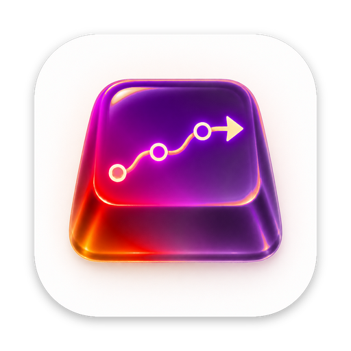
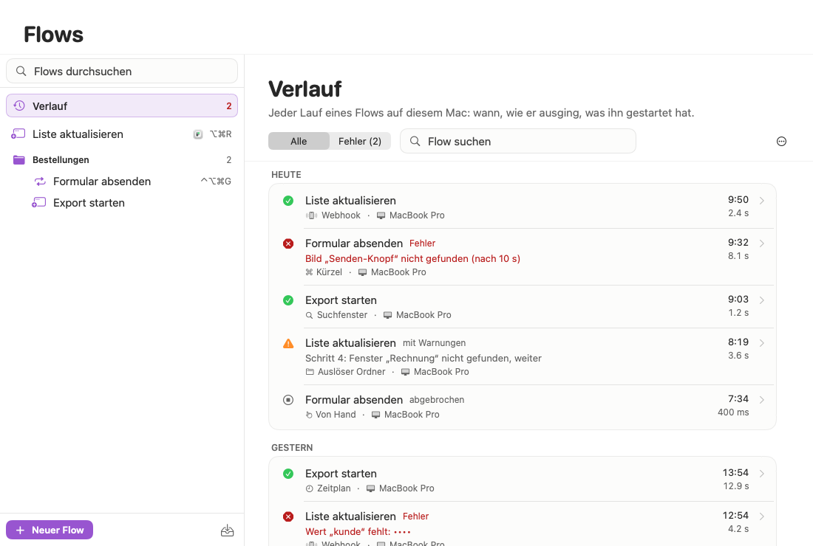
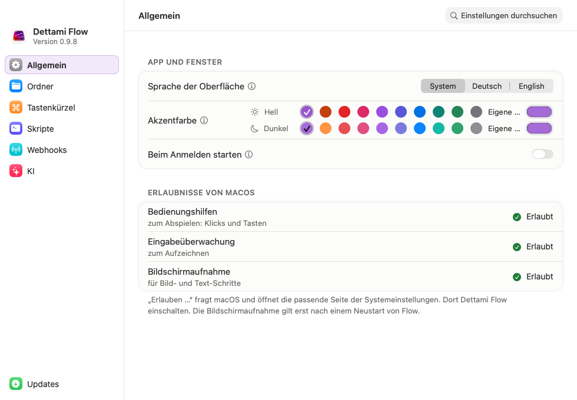
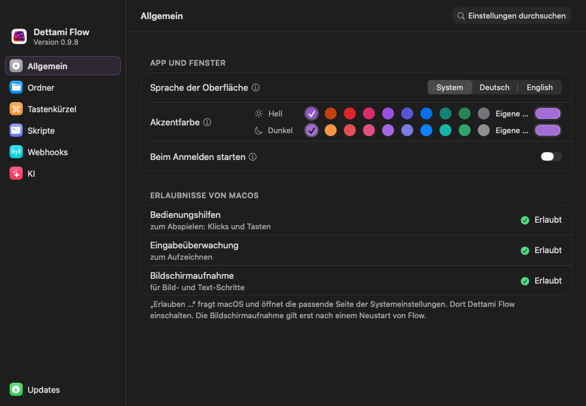
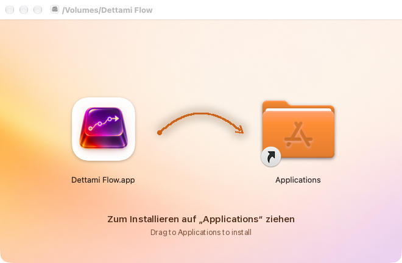

<div align="center">

**Deutsch** · [English](README.en.md)



# Dettami Flow

**Abläufe für den Mac: klicken, tippen, Fenster steuern, Skripte und KI, per Kürzel, Zeitplan oder vom iPhone.**

Gratis · für macOS 26 und neuer · von Apple notarisiert

<a href="https://github.com/Stebibastian/dettami-flow-releases/releases/latest"></a>

<a href="https://github.com/Stebibastian/dettami-flow-releases/releases/latest"></a>


<br>



</div>

---

## Worum es geht

Dettami Flow nimmt Dir wiederkehrende Handgriffe am Mac ab. Ein **Flow** ist eine Folge von Schritten: auf einen Knopf oder einen Text auf dem Bildschirm klicken, Text tippen, Tasten drücken, eine App nach vorne holen, ein Skript starten, die KI fragen. Gestartet wird er per Tastenkürzel, nach Zeitplan, wenn eine App nach vorne kommt, wenn eine Datei in einem Ordner landet, über das Clipboard oder vom iPhone aus.

Flow ist die Mac-App für Abläufe aus der Familie von [Dettami](https://apps.apple.com/app/id6812090257) (Diktat, Clipboard, Snippets, Quick AI). Seit Dettami 1.2 laufen die früheren Makros von Dettami hier.

## Auf einen Blick

| | |
|---|---|
| 🧩 **Flows aus Bausteinen** | Klicks, Tasten, Text, Pausen, Fenster, Menüpunkte, Links, Verzweigungen, Schleifen, Variablen, Abfragen, Meldungen |
| 👁️ **Sieht den Bildschirm** | Auf Text oder ein Bild warten und daraufklicken, auch wenn sich das Fenster verschiebt |
| ⚡ **Viele Auslöser** | Tastenkürzel, Zeitplan, Intervall, App, Ordner, Clipboard, Webhook |
| 📜 **Skripte** | Shell, Bash, AppleScript, JavaScript, Python direkt im Flow oder aus dem Skripte-Ordner `_skripte/` |
| ✨ **KI-Schritte** | „KI fragen“ und ein KI-Assistent, der Flows im Chat vorschlägt |
| 📁 **Dein Ordner** | Eine lesbare JSON-Datei pro Flow, in iCloud Drive, OneDrive, Nextcloud, Dropbox, auf dem NAS oder in Git |
| 📡 **Kanäle** | Flows an Kolleginnen und Kollegen verteilen, auch an Macs ohne iCloud |
| 📱 **Fernbedienung** | Flows vom iPhone starten, mit Dettami aus dem App Store |

## Funktionen

### Flows bauen

- **Neuer Flow** mit ⌘N: leer aus den Bausteinen, **aufnehmen** (Klicks und Tasten werden Schritt für Schritt aufgezeichnet) oder **mit KI erstellen** (im Chat beschreiben, was der Flow tun soll; die KI schlägt die Schritte vor).
- Vorlagen für Häufiges: **Text vom Bildschirm** (Bereich aufziehen, Text erkennen, ins Clipboard) und **Kürzel umbelegen** (in einer App ein eigenes Kürzel, das eine andere Taste drückt oder einen Menüpunkt wählt).
- **Bausteine**: Klick (auch an der Mausposition), Klick auf Text oder Bild, Warten auf Text oder Bild, Text tippen, Tasten, Pause, App aktivieren, Link öffnen, Menüpunkt wählen, Fenster anpassen, Variable setzen, Abfrage, Meldung zeigen, Verzweigung, Schleife, „Für jedes“, Kommentar, Skript, Telegram-Nachricht und mehr.
- **Testen** wie in einem Debugger: Schritt für Schritt abspielen, einzelne Schritte ausschalten, Rückgängig.
- **Import** aus Keyboard Maestro (`.kmmacros`) und aus geteiltem Ablauf-Code.
- **Gilt in**: Ein Flow oder ein ganzer Ordner von Flows gilt überall oder nur in bestimmten Apps.

### Auslöser

Ein Flow startet von Hand, aus der Menüleiste oder über einen oder mehrere Auslöser:

- **Tastenkürzel** (Flow warnt, wenn Dettami das Kürzel schon belegt)
- **Zeitplan** (tägliche Uhrzeiten) und **Intervall** (alle n Minuten)
- **App**: wenn eine bestimmte App startet, beendet wird, nach vorne kommt oder in den Hintergrund geht
- **Ordner**: wenn in einem Ordner eine Datei dazukommt oder verschwindet
- **Clipboard**: wenn Text oder ein Bild kopiert wird
- **Webhook**: von aussen, etwa vom iPhone (siehe unten)

### Schnell starten: Flows durchsuchen

Mit **⌃⌥⌘M** oder über die Menüleiste öffnet sich das Fenster **„Flows durchsuchen“**: tippen, mit `#Ordner` eingrenzen, Schritte und Infos ansehen, mit ↩ in der App ausführen, die gerade vorne war. ⌘K zeigt weitere Aktionen (bearbeiten, im Finder zeigen, ausschalten, Schritt für Schritt).

### Verlauf

Über der Liste steht der **Verlauf**: jeder Lauf auf diesem Mac mit Zeit, Dauer, Ergebnis, Fehlerzeile, Auslöser und Mac, nach Tag gegliedert, mit Filter „Alle | Fehler“ und Suche. Eingetippte und geheime Werte stehen nie darin.

### Skripte-Ordner `_skripte/`

- Im Flow-Ordner liegt `_skripte/`. Der Baustein **„Skript aus Datei“** startet ein Skript daraus wie im Terminal. Änderst Du die Datei, gilt das sofort für alle Flows, die sie nutzen.
- Einstellungen > Skripte zeigt die Liste, legt neue Skripte an, setzt das Ausführrecht und zeigt sie im Finder.
- **Weitere Skript-Ordner** lassen sich einbinden, z. B. Deine Raycast Script Commands. Flow startet sie dort, ohne sie zu kopieren. Mit „In _skripte übernehmen“ reist ein Skript mit Deinen Flows mit.

### Ein Ordner statt einer Datenbank

Flow speichert alles in einem **Ordner, den Du wählst**: iCloud Drive, OneDrive, Nextcloud, Dropbox, ein NAS oder ein Git-Repository.

```
Flows/
  _flow.json                         Reihenfolge, Ordner, Favoriten, Einstellungen
  Formular absenden (3F2A9C1B).json  ein Flow, lesbares JSON
  Formular absenden (3F2A9C1B).bilder/
  Büro/                              ein Ordner von Flows
  _skripte/                          Skripte für „Skript aus Datei“
  _papierkorb/                       gelöschte Flows, nie endgültig weg
```

- **Eine Datei pro Flow**, sauber formatiert: Git-Diffs zeigen genau, was sich geändert hat.
- Änderungen von einem anderen Mac kommen von selbst an. Bei einem Konflikt fragt Flow, welche Fassung gelten soll.
- Ist der Ordner nicht erreichbar (offline, Laufwerk abgesteckt), arbeitet Flow mit dem letzten Stand weiter.
- Gelöschte Flows landen im `_papierkorb/`, nicht im Nichts.
- Werte **geheimer Variablen** stehen nie im Ordner, sie bleiben im Schlüsselbund.

### Kanäle: Flows im Team teilen

Neu in 0.10.0. Ein Mac **veröffentlicht** Flows oder ganze Ordner in einen geteilten Ordner, andere Macs **abonnieren** ihn unter Einstellungen > Kanäle.

- Funktioniert mit **OneDrive und SharePoint**, einem **NAS (SMB)** oder **Dropbox**. iCloud ist dafür nicht nötig.
- Abonnierte Flows stehen in einer eigenen Gruppe mit Schloss: ausführbar, mit Kürzeln und Auslösern, aber nur lesbar. **„Kopie bearbeiten“** macht daraus einen eigenen Flow. Auslöser lassen sich pro Mac ausschalten.
- Änderungen und zurückgezogene Flows kommen von selbst an. Ist der Kanal offline, laufen die Flows im letzten Stand weiter.
- **Geheime Werte gehen nie in einen Kanal.** Fehlt auf dem anderen Mac eine geheime Variable, zeigt Flow „fehlt, bitte eintragen“ und legt sie dort im Schlüsselbund ab.

### Fernbedienung vom iPhone

Mit [Dettami für das iPhone](https://apps.apple.com/app/id6812090257) startest Du Flows vom iPhone aus, wählst den Mac und siehst, ob der Lauf geklappt hat. Die Nachricht läuft über einen Webhook-Dienst (ntfy). Der Webhook-Zugang wird in Flow unter Einstellungen > Webhooks eingerichtet. Optional schickt Flow auch Nachrichten an Telegram.

> Die Liste der Flows kommt über Dettami auf dem Mac und dessen iCloud-Abgleich aufs iPhone. Für die Fernbedienung braucht es darum Dettami auf Mac und iPhone.

### KI

- Schritt **„KI fragen“** und **KI-Assistent** für Flows, mit Claude, ChatGPT, Apple Intelligence oder einem lokalen Modell über **Ollama**.
- Für Claude und ChatGPT nutzt Flow Deinen eigenen Schlüssel aus Dettami (Text verbessern), er wird nie angezeigt. Vor dem ersten Senden bestätigst Du den Hinweis. Es geht nur hinaus, was der Schritt nennt, nie geheime Variablen.

### Aussehen

Einstellungen im Stil von Dettami, mit Suche, Sprache der Oberfläche (Deutsch oder Englisch) und einer eigenen **Akzentfarbe** für Hell und Dunkel. Ab Werk ein leichtes Violett.

<div align="center">


</div>

## Systemvoraussetzungen

- **macOS 26 (Tahoe) oder neuer**, Apple Silicon oder Intel
- Für die Fernbedienung: Dettami auf Mac und iPhone
- Für Claude oder ChatGPT: ein eigener Schlüssel, eingetragen in Dettami. Apple Intelligence und Ollama gehen ohne Schlüssel.

## Installation

1. **[Neueste Version laden](https://github.com/Stebibastian/dettami-flow-releases/releases/latest)**: unter „Assets“ die Datei `DettamiFlow-<Version>.dmg`.
2. Die DMG öffnen und **Dettami Flow auf „Applications“ ziehen**.

   

3. Dettami Flow aus dem Ordner Programme starten. Die Einrichtung führt durch drei kurze Schritte:
   - **Ordner wählen** für Deine Flows. Liegt dort schon ein Export aus Dettami, lädt Flow ihn.
   - **Aus Dettami übernehmen**, falls Du Makros in Dettami hattest (siehe FAQ).
   - **Erlaubnisse** von macOS erteilen:

| Erlaubnis | Wofür |
|---|---|
| **Bedienungshilfen** | Klicks und Tasten abspielen |
| **Eingabeüberwachung** | Klicks und Tasten aufnehmen, Tastenkürzel |
| **Bildschirmaufnahme** | Bild- und Text-Schritte (Text oder Bild auf dem Bildschirm finden) |

„Erlauben …“ öffnet jeweils die passende Seite der Systemeinstellungen. Die Bildschirmaufnahme gilt erst nach einem Neustart von Flow, dafür gibt es den Knopf „Flow neu starten“. Später findest Du alles unter Einstellungen > Allgemein.

## Updates

Flow aktualisiert sich selbst über [Sparkle](https://sparkle-project.org). Updates kommen signiert aus diesem Repository.

- Einstellungen > Updates > **„Jetzt nach Updates suchen …“**, oder
- den Schalter **„Automatisch nach Updates suchen“** einschalten, dann fragt Flow einmal am Tag nach.

Ab Werk ist das automatische Suchen aus: Ohne Klick oder Schalter fragt Flow nie nach Updates.

## Häufige Fragen

<details>
<summary><b>Ist Dettami Flow gratis?</b></summary>

Ja. Flow ist gratis, ohne Abo, ohne Paywall und ohne Konto.
</details>

<details>
<summary><b>Warum ist Flow nicht im App Store?</b></summary>

Apps im Mac App Store laufen in einer Sandbox. Flow muss andere Apps fernsteuern, Klicks und Tasten abspielen, Skripte frei starten und Ordner beobachten, die Du wählst. Das geht in der Sandbox nicht oder nur stark eingeschränkt. Darum kommt Flow direkt von hier: mit **Developer ID signiert und von Apple notarisiert**, Updates über Sparkle.
</details>

<details>
<summary><b>Wo sind meine Makros aus Dettami?</b></summary>

Seit Dettami 1.2 laufen Makros in Dettami Flow. Dettami löscht sie nicht, sie liegen weiter sicher auf Deinem Mac. So holst Du sie herüber:

- **Am einfachsten:** Beim ersten Start von Flow „Aus Dettami übernehmen“ wählen. Flow liest die Makros samt Bildern nur lesend aus Dettami, dazu die Einstellungen für Webhooks und Telegram. Werte geheimer Variablen und Tokens kommen nicht mit.
- **Oder per Export:** In Dettami unter Einstellungen > Allgemein „Makros in Ordner exportieren …“ wählen und diesen Ordner beim ersten Start von Flow öffnen.

Solange Flow läuft, pausiert Dettami seine eigenen Makro-Auslöser, damit nichts doppelt läuft.
</details>

<details>
<summary><b>Brauche ich iCloud?</b></summary>

Nein. Flow braucht kein iCloud-Konto und keinen Abgleich über Apple. Deine Flows liegen in einem Ordner Deiner Wahl. Willst Du mehrere Macs, nimm einen Ordner in iCloud Drive, OneDrive, Nextcloud oder Dropbox, oder verteile Flows über Kanäle. Nur die Fernbedienung vom iPhone nutzt den iCloud-Abgleich von Dettami.
</details>

<details>
<summary><b>Wie teile ich Flows mit Kolleginnen und Kollegen?</b></summary>

Mit **Kanälen** (Einstellungen > Kanäle): Auf Deinem Mac „Kanal anlegen …“ und einen geteilten Ordner wählen (OneDrive, SharePoint, NAS oder Dropbox), dann Flows per Rechtsklick „Im Kanal veröffentlichen“. Den Ordner für die anderen freigeben (nur Lesen genügt). Auf jedem anderen Mac „Kanal abonnieren …“ und denselben Ordner wählen. Geheime Werte gehen dabei nie mit.
</details>

<details>
<summary><b>Ist die App signiert? Meldet macOS eine Warnung?</b></summary>

Die App ist mit **Developer ID signiert und von Apple notarisiert** (Gatekeeper: „Notarized Developer ID“), auch jedes Update. Sie startet ohne Umweg über „Trotzdem öffnen“.

Ehrlicher Hinweis zur Hülle: Die **DMG-Datei selbst** ist zwar notarisiert, trägt aber noch keine eigene Signatur. Beim Installieren merkst Du davon nichts, denn macOS prüft beim Start die App. Die Signatur der DMG kommt mit einem der nächsten Releases.
</details>

<details>
<summary><b>Was passiert mit meinen Daten?</b></summary>

Siehe [Datenschutz](#datenschutz): Flow hat kein Konto, keine Analyse und keine Telemetrie. Ins Netz geht nur, was Du selbst einrichtest.
</details>

<details>
<summary><b>Wo ist der Quellcode?</b></summary>

Dettami Flow ist nicht quelloffen. Dieses Repository enthält nur die Releases (DMG und Update-Dateien) und den Update-Feed `appcast.xml` für Sparkle.
</details>

## Datenschutz

- **Kein Konto, keine Analyse, keine Telemetrie, keine Werbung.**
- Flows liegen als Dateien in dem Ordner, den Du wählst. Werte geheimer Variablen nur im Schlüsselbund des Mac.
- Ins Netz geht Flow nur für das, was Du einschaltest:
  - **Updates** über GitHub, nur auf Klick oder mit dem Schalter
  - **Webhooks** (ntfy) für die Fernbedienung vom iPhone, nur wenn eingerichtet
  - **Telegram**, nur in Flows mit diesem Schritt
  - **KI-Schritte** an Claude oder ChatGPT, nur mit Deinem Schlüssel und nach Deiner Bestätigung. Apple Intelligence und Ollama bleiben auf dem Mac.
- Der Verlauf der Läufe bleibt auf diesem Mac und enthält nie eingetippte oder geheime Werte.

## Support

Fragen, Fehler oder Wünsche: **[Support von Dettami](https://kardos.cloud/apps/dettami/support.html)**.

## Was ist neu

Alle Versionen und Änderungen: **[Releases](https://github.com/Stebibastian/dettami-flow-releases/releases)**. In der App zeigt Sparkle die Neuerungen vor jedem Update.

---

<div align="center">
<sub>© Sebastian Kardos. Alle Rechte vorbehalten. · Dettami Flow ist nicht mit Apple, Keyboard Maestro oder Raycast verbunden.</sub>
</div>
